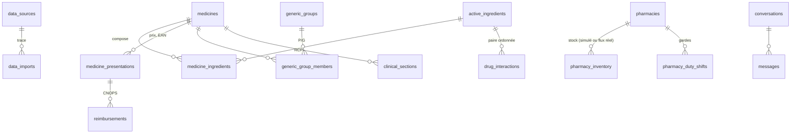

# Pipeline de données

## Principes
1. **Provenance systématique.** Chaque ligne métier référence `data_sources` ; chaque exécution crée une ligne `data_imports` (fichier, empreinte SHA-256, date de version de la source, compteurs, anomalies).
2. **Quatre statuts.** `official` (autorité publique), `reference` (source scientifique tierce), `unverified` (non vérifiée), `simulated` (démonstration).
3. **Priorité des sources.** Une donnée n'est jamais dégradée par une source de rang inférieur. Un prix n'est remplacé que par un prix de date de version égale ou plus récente ; l'ancienne valeur est journalisée.
4. **Rien n'est inventé.** Les substances inconnues sont rejetées, les EAN invalides sont signalés et ignorés, les lignes incohérentes sont rejetées avec leur numéro.
5. **Idempotence.** Relancer un import met à jour sans dupliquer (clés `source_record_key`, contraintes d'unicité).

## Commandes (depuis `backend/`)
```bash
alembic upgrade head                                   # schéma (22 tables, index trigramme)
python -m app.ingestion.cli seed                       # référentiel + échantillons officiels + démo simulée
python -m app.ingestion.cli seed --no-simulated        # sans données simulées
python -m app.ingestion.cli import-cnops ../data/raw/ref-des-medicaments-cnops-2014.xlsx --dry-run
python -m app.ingestion.cli import-cnops ../data/raw/ref-des-medicaments-cnops-2014.xlsx
python -m app.ingestion.cli import-ammps export_ammps.xlsx --version-date 2026-10-01
python -m app.ingestion.cli import-generics repertoire.csv --edition "Projet – Janvier 2026"
python -m app.ingestion.cli fetch-osm && python -m app.ingestion.cli import-osm ../data/raw/osm_pharmacies_AAAA-MM-JJ.json
python -m app.ingestion.cli import-duty gardes.csv
python -m app.ingestion.cli import-rcp rcp.pdf --medicine-id 12 --source-url https://... --from-ammps
python -m app.ingestion.cli import-interactions ddinter_A.csv --source ddinter
python -m app.ingestion.cli purge-simulated            # avant une démo « données réelles uniquement »
python -m app.ingestion.cli purge-expired              # rétention des conversations et identifications
python -m app.ingestion.cli stats
```

## Modèle (résumé)

Autres tables : `laboratories`, `pharmaceutical_forms` (libellé source + forme canonique), `therapeutic_classes`, `medicine_images`, `identification_results` (empreinte d'image seulement, expiration), `nlp_utterances`.

## Résultat du chargement initial (exécuté le 25/10/2026)
| Import | Lues | Insérées | Rejetées | Anomalies signalées |
|---|---|---|---|---|
| AMMPS médicaments (page 1) | 12 | 12 | 0 | — |
| Répertoire génériques (extrait) | 28 | 27 | 1 (ligne parasite) | code à 14 chiffres, EAN invalide |
| Registre pharmacies AMMPS (page 1) | 20 | 20 | 0 | — |
| Démo simulée (médicaments / pharmacies) | 8 / 9 | 8 / 9 | 0 | — |

Second passage : 0 insertion (idempotence vérifiée). Jointure inter-sources vérifiée : A.V.T. boîte de 10 = PPV 10,70 DH (AMMPS 01/10/2026) + EAN 6118000031055 (répertoire).
