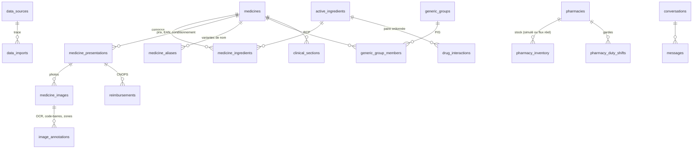

# Pipeline de données

## Principes
1. **Provenance systématique.** Chaque ligne métier référence `data_sources` (licence, conditions, **marché**) ; chaque exécution crée une ligne `data_imports` (fichier, empreinte SHA-256, date de version de la source, compteurs, anomalies).
2. **Quatre statuts.** `official` (autorité publique), `reference` (source scientifique tierce), `unverified` (non vérifiée), `simulated` (démonstration).
3. **Priorité des sources.** Une donnée n'est jamais dégradée par une source de rang inférieur. Un prix n'est remplacé que par un prix de date de version égale ou plus récente ; l'ancienne valeur est journalisée. Une ligne moins fiable visant une fiche plus fiable est **rejetée en entier** (aucune présentation ni aucun prix n'y est rattaché).
4. **Rien n'est inventé.** Les substances inconnues sont rejetées, les EAN invalides sont signalés et ignorés, les lignes incohérentes sont rejetées avec leur numéro, un conditionnement ambigu reste vide.
5. **Idempotence.** Relancer un import met à jour sans dupliquer (clés `source_record_key`, contraintes d'unicité).
6. **Marchés séparés.** Les sources étrangères (BDPM) n'enrichissent que la terminologie ; aucune présentation ni aucun prix étranger n'entre dans le catalogue.

## Étapes et implémentation
| Étape | Où | Ce qui est fait |
|---|---|---|
| Extraction | `common.read_rows` | CSV (UTF-8 ou CP1252, `;` ou `,`) et XLSX, détection de la ligne d'en-têtes par synonymes de colonnes ; BDPM : texte tabulé Latin-1 (`bdpm.read_bdpm_compositions`) |
| Validation | importeurs | Nom obligatoire, lignes parasites du répertoire rejetées, EAN-13/GTIN-14 (clé GS1), période de garde cohérente, substance connue pour les interactions |
| Nettoyage | `nlp.text.normalize_text` | Casse, accents, chiffres arabes, ponctuation, `500mg` → `500 mg`, virgule décimale |
| Normalisation | `common` | Prix AMMPS (`4.303.00 DH`, `10,70`, `SANS PPV`), dosages par substance et concentrations (`parse_strength`, `split_strengths`), formes canoniques (`canonical_form`), conditionnement (`parse_pack`), substances via synonymes |
| Déduplication | clés + `strengths_equivalent` | Clé spécialité = nom + dosage + forme ; présentation = fiche + libellé ; membre du répertoire = groupe + libellé ; doublons probables signalés par le contrôle qualité |
| Chargement | `upsert_medicine`, `upsert_presentation` | Respect du rang des statuts et des dates de version, texte de recherche recalculé (`refresh_search_text`) |
| Contrôle qualité | `quality.run_quality_checks` | 7 contrôles critiques, 9 avertissements (voir plus bas) |

### Règles qui empêchent de confondre des dosages
- `parse_strength` ne calcule une masse en mg que pour mg, g et µg : « 80 MG / ML » reste une concentration (`mg/ml`), jamais 80 mg.
- `split_strengths` ne répartit un dosage entre substances que si le nombre de valeurs correspond au nombre de substances ; sinon le texte est conservé tel quel, sans répartition devinée.
- `strengths_equivalent` compare numériquement deux écritures (« 0,5 G » = « 500 MG », « 0,02 » = « 2 % ») et renvoie *incomparable* plutôt que *égal* en cas de doute.
- Répertoire : un membre dont le dosage ou la forme diffère de son groupe n'est **pas** rattaché (`match_method = inconsistent`).
- Recherche : un dosage demandé absent n'est jamais remplacé ; les dosages disponibles sont proposés (`available_dosages`).

## Commandes (depuis `backend/`)
```bash
python -m alembic upgrade head                                  # schéma (révisions 0001 + 0002)
python -m app.ingestion.cli seed                                # référentiel + échantillons officiels + démo simulée
python -m app.ingestion.cli seed --no-simulated                 # sans données simulées
python -m app.ingestion.cli import-ammps export_ammps.xlsx --version-date 2026-10-01
python -m app.ingestion.cli import-generics repertoire.csv --edition "Projet – Janvier 2026" --version-date 2026-01-12
python -m app.ingestion.cli import-cnops ../data/raw/ref-des-medicaments-cnops-2014.xlsx --dry-run
python -m app.ingestion.cli import-cnops ../data/raw/ref-des-medicaments-cnops-2014.xlsx
python -m app.ingestion.cli import-bdpm ../data/raw/bdpm_AAAA-MM-JJ/CIS_COMPO_bdpm.txt --version-date AAAA-MM-JJ
python -m app.ingestion.cli import-aliases variantes.csv        # modèle : data/templates/medicine_aliases_TEMPLATE.csv
python -m app.ingestion.cli fetch-osm && python -m app.ingestion.cli import-osm ../data/raw/osm_pharmacies_AAAA-MM-JJ.json
python -m app.ingestion.cli import-duty gardes.csv
python -m app.ingestion.cli import-rcp rcp.pdf --medicine-id 12 --source-url https://... --from-ammps
python -m app.ingestion.cli import-interactions ddinter_A.csv --source ddinter
python -m app.ingestion.cli quality --strict                    # code de sortie 1 si un contrôle critique échoue
python -m app.ingestion.cli reindex-search                      # recalcule le texte de recherche de toutes les fiches
python -m app.ingestion.cli purge-simulated                     # avant une démo « données réelles uniquement »
python -m app.ingestion.cli purge-expired                       # rétention des conversations et identifications
python -m app.ingestion.cli stats
```
Ordre recommandé pour un chargement réel : AMMPS → répertoire → CNOPS → BDPM → variantes → `quality --strict`.

## Contrôle qualité (`quality`)
| Code | Niveau | Vérifie |
|---|---|---|
| `simulated_presentation_on_real_medicine` | critical | aucune présentation simulée sous une fiche réelle |
| `invalid_ean_stored` | critical | tout EAN-13 stocké a une clé de contrôle valide |
| `duplicate_ean_across_medicines` | critical | un EAN-13 ne désigne qu'une spécialité |
| `official_status_from_non_official_source` | critical | le statut `official` ne vient que d'une source officielle |
| `price_without_date` | critical | tout prix réel a une date de validité |
| `historical_price_as_current` | critical | aucun prix CNOPS 2014 stocké comme prix courant |
| `foreign_market_in_catalog` | critical | aucune spécialité issue d'un marché étranger |
| `duplicate_medicine_candidates` | warning | même nom + forme canonique + composition dosée sous plusieurs fiches |
| `medicine_without_ingredient`, `medicine_without_presentation` | warning | fiches incomplètes |
| `unstructured_strength` | warning | plusieurs substances, dosage non réparti |
| `generic_member_unlinked` | warning | membres du répertoire non rattachés |
| `repertoire_medicine_orphan` | warning | fiche du répertoire qui n'est plus rattachée (ancienne analyse de libellé) |
| `price_anomaly` | warning | PPV ≤ 0 ou PH > PPV |
| `stale_price` | warning | prix de plus de 2 ans |
| `image_without_presentation` | warning | photo non rattachée à une présentation |

### Base de développement créée avant le 26/10/2026
L'ancienne analyse du répertoire avait créé la fiche erronée « FUSIDATE PHARMA » de dosage « 5 2% ». Après `alembic upgrade head` puis `seed`, la fiche corrigée « FUSIDATE PHARMA 5 » (2 %) est créée et l'ancienne est signalée par `repertoire_medicine_orphan`. **Rien n'est supprimé automatiquement.** Pour la retirer : sauvegarder (`docker compose exec db pg_dump -U medisight medisight > sauvegarde.sql`), vérifier l'identifiant donné par `quality`, puis supprimer cette fiche seule (`DELETE FROM medicines WHERE id = <id> AND dosage_text = '5 2%';`).

## Modèle (résumé)

Autres tables : `laboratories`, `pharmaceutical_forms` (libellé source + forme canonique), `therapeutic_classes`, `identification_results` (empreinte d'image seulement, expiration), `nlp_utterances`.

### Chaîne du Pill Identifier : photo → présentation → fiche
| Besoin | Support dans le schéma (révision 0002) |
|---|---|
| Plusieurs photos d'une même présentation | `medicine_images.presentation_id` (n photos → 1 présentation), empreinte `sha256` **unique** (pas de doublon de fichier) |
| Face photographiée, taille, date | `view` (`front`, `back`, `side`, `top`, `bottom`, `inside`, `other`), `width_px`, `height_px`, `captured_at` |
| Langue des inscriptions | `packaging_languages` (ex. `["fr", "ar"]`) ; `image_annotations.language` par texte lu |
| Provenance et droits | `origin` (`team_photo`, `manufacturer`, `public_dataset`, `user_consented`), `license`, `attribution`, `source_id`, `data_status`, `is_moroccan_reference` |
| Codes-barres | `medicine_presentations.ean13` (EAN-13 validé) ; GTIN-14 DataMatrix ramené à l'EAN-13 ; recherche exacte par code dans `/api/medicines/search` |
| Noms commerciaux et variantes | `medicine_aliases` (écriture arabe, graphie de l'emballage, variante OCR), toujours sourcées, incluses dans la recherche |
| Dosage exact | `medicine_ingredients.strength_*` (valeur, unité, mg) par substance |
| Conditionnement | `pack_quantity` + `pack_unit` (déduits seulement sans ambiguïté), libellé d'origine conservé |
| Annotations OCR futures | `image_annotations` : type (`ocr_text`, `brand`, `dosage`, `barcode`, `pack_size`, `lot`, `expiry`, zones), valeur, `bbox`, `confidence`, `annotator` (`human` / `model`), `model_name`, `is_verified` |

## Résultat du chargement (exécuté le 26/10/2026 sur une base neuve, PostgreSQL 16)
| Import | Lues | Insérées | Rejetées | Anomalies signalées |
|---|---|---|---|---|
| Référentiel de substances | 20 | — | — | — |
| AMMPS médicaments (page 1) | 12 | 12 | 0 | — |
| Répertoire génériques (extrait) | 28 | 27 | 1 (ligne parasite) | GTIN-14 logistique (CLARISCAN), EAN invalide (LOWRAC boîte de 15) |
| Registre pharmacies AMMPS (page 1) | 20 | 20 | 0 | — |
| Démo simulée (médicaments / pharmacies) | 8 / 9 | 8 / 9 | 0 | — |
| BDPM compositions (29/09/2026) | 32 439 | — | 0 | 12 substances codées, 8 avec termes de sel |

Base obtenue : 41 spécialités (33 `official`, 8 `simulated`), 45 présentations dont 23 avec EAN-13 valide et 33 avec conditionnement structuré, 8 groupes génériques, 27 membres (25 créés depuis le répertoire, 2 rattachés à une fiche AMMPS existante, 0 incohérent). Contrôle qualité : **0 critique, 0 avertissement**. Second passage : 0 insertion (idempotence vérifiée).
